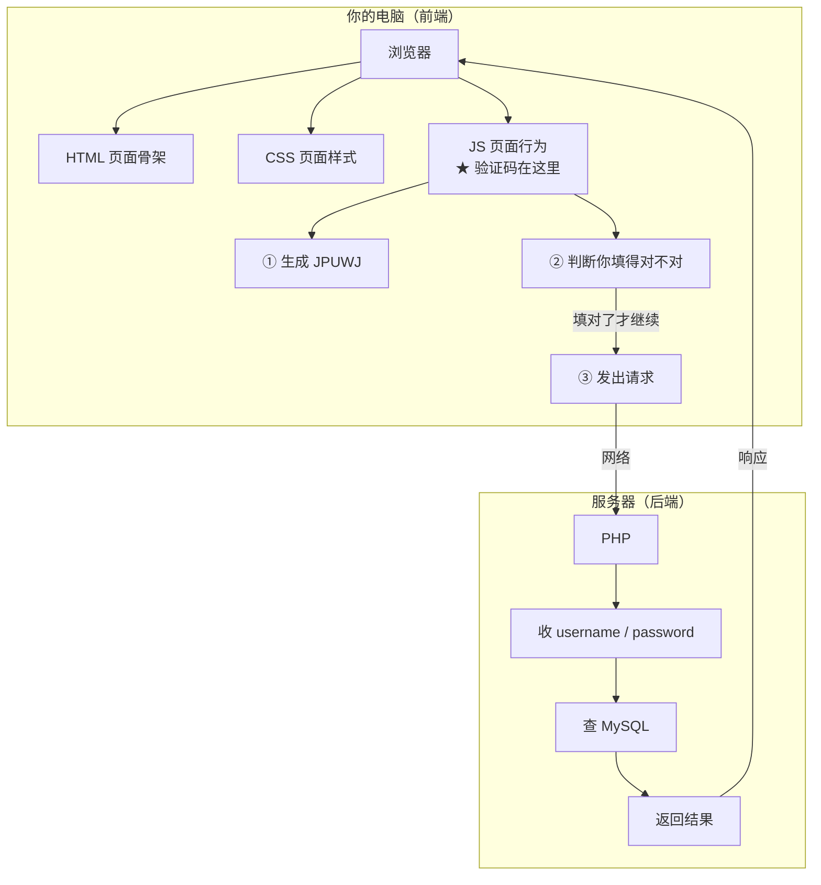
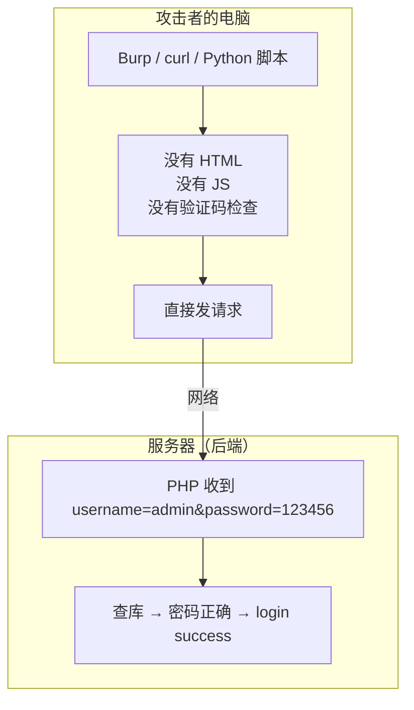

# 验证码写在前端，等于没写：Pikachu「验证码绕过(on client)」复盘
> 这关的验证码不是图片，而是一个只读文本框，里面用 JavaScript 现场随机生成 5 位字符。我先试了禁用 JS，结果关掉 DevTools 再刷新，验证码又回来了——因为 Chrome 里那个"禁用 JS"只在面板打开时有效。折腾一圈才明白：**这题根本不该在浏览器里做**。
## 一、环境与目标
| 项目 | 内容 |
| --- | --- |
| 靶场 | Pikachu |
| 运行环境 | phpStudy（Apache 2.4.39 + MySQL 5.7.26 + PHP 7.3.4 NTS） |
| 站点根目录 | `D:\Pikachu` |
| 访问方式 | `http://pikachu/` |
| 关卡位置 | 暴力破解 → 验证码绕过(on client) |
| 页面地址 | `http://pikachu/vul/burteforce/bf_client.php` |
| 工具 | 浏览器 DevTools、Burp Suite、Python |
## 二、这道题在考什么
### 2.1 页面结构
和上一关长得差不多，但验证码那一块变了：
```html
<input class="vcode" name="vcode" placeholder="验证码" type="text" />
<label>
  <input type="text" onclick="createCode()" readonly="readonly"
         id="checkCode" class="unchanged" style="width: 100px" />
</label>
```
注意两点：
1. **没有 ``**，验证码不是图片；
2. 真正的"题目"是一个 `readonly` 的文本框，`id="checkCode"`，点它会重新生成。
### 2.2 前端源码
页面底部两段 JS：
```js
var code;   // 全局变量，存放当前验证码
function createCode() {
    code = "";
    var codeLength = 5;
    var selectChar = new Array(0,1,2,...,'Z');
    for (var i = 0; i < codeLength; i++) {
        var charIndex = Math.floor(Math.random() * 36);
        code += selectChar[charIndex];
    }
    if (checkCode) {
        checkCode.className = "code";
        checkCode.value = code;     // 直接写进输入框
    }
}
function validate() {
    var inputCode = document.querySelector('#bf_client .vcode').value;
    if (inputCode.length <= 0) {
        alert("请输入验证码！");
        return false;
    } else if (inputCode != code) {
        alert("验证码输入错误！");
        createCode();
        return false;
    }
    return true;
}
createCode();   // 页面加载完立即生成一次
```
拆开看：
| 动作 | 在哪执行 |
| --- | --- |
| 生成 `code` | 浏览器（`Math.random()`） |
| 比对 `inputCode != code` | 浏览器 |
| 阻止提交 (`return false`) | 浏览器 |
**全程没有一次网络请求。**
### 2.3 后端源码
`bf_client.php` 的 PHP 部分：
```php
if(isset($_POST['submit'])){
    if($_POST['username'] && $_POST['password']) {
        $username = $_POST['username'];
        $password = $_POST['password'];
        $sql = "select * from users where username=? and password=md5(?)";
        $line_pre = $link->prepare($sql);
        $line_pre->bind_param('ss', $username, $password);
        // ...
    }
}
```
**`$_POST['vcode']` 从头到尾没有出现过。**
### 2.4 和上一关的区别
|  | on server | on client |
| --- | --- | --- |
| 验证码谁生成 | 服务器画图 | 浏览器 JS 随机 |
| 在哪校验 | 服务器 | 浏览器 |
| 服务端验了吗 | 验了，但有两个洞 | **完全没验** |
| 本质 | 锁装错了位置 | 门上根本没有锁 |
## 三、常规操作
这关的"标准解法"其实有两类：
**思路 A：让前端校验不执行**
1. 打开页面，F12；
2. 禁用 JavaScript（或者删掉 `onsubmit="return validate();"`）；
3. 填用户名密码，验证码留空或乱填；
4. 提交，请求直达服务器。
**思路 B：根本不经过浏览器**
1. 用 Burp / curl / 脚本直接发 POST；
2. 参数里**不带 `vcode`**，或者随便带一个；
3. 服务器照常处理。
思路 B 才是这个漏洞真正想说明的事。
## 四、我的实操步骤
### 4.1 尝试禁用 JS
1. 浏览器按 `F12` 打开开发者工具；
2. 按 `Ctrl + Shift + P` 调出命令菜单；
3. 输入 `Disable JavaScript`，点击执行；
4. 按 `F12` 关闭面板，按 `F5` 刷新页面。
刷新后，验证码框确实空了——因为 `createCode()` 没执行，`checkCode.value` 是空的。
### 4.2 尝试直接提交
在 `Username` 填 `admin`，`Password` 填 `123456`，验证码框**留空**，点 Login。
**结果：弹出「请输入验证码！」**
### 4.3 尝试乱填验证码
在验证码框随便填了个 `1`，再点 Login。
**结果：弹出「验证码输入错误！」**
两次都卡住了，一条请求都没发出去。
## 五、踩坑记录：为什么禁用 JS 也没用
### 5.1 现象
浏览器里弹的两个框——「请输入验证码！」和「验证码输入错误！」——都来自这段代码：
```js
if (inputCode.length <= 0) {
    alert("请输入验证码！");
    return false;
} else if (inputCode != code) {
    alert("验证码输入错误！");
    return false;
}
```
**能弹出这两个框，就说明 JS 正在运行。** 也就是说，我以为已经禁用掉的 JavaScript，其实并没有被禁用。
### 5.2 原因：关掉 DevTools，JS 就恢复了
Chrome 里通过命令菜单执行的 `Disable JavaScript`，是**依附于 DevTools 会话的**：面板一关，这个状态就恢复，页面重新开始执行 JS。
我的操作顺序正好踩中这个坑：
```
禁用 JS  →  F12 关面板  →  F5 刷新  →  此时 JS 已经恢复
```
所以刷新后：
- `createCode()` 又跑了一次，`checkCode` 重新生成了新值
- 我点 Login，`validate()` 又跑了一次，直接拦下
**解决办法：禁用 JS 之后不要关 DevTools，让面板开着直接提交。**
### 5.3 更关键的一层：方向本身就偏了
退一步说，就算 JS 真的被禁用了、请求真的发出去了，那也只是"我的浏览器不发这条请求"的问题。
而这个漏洞的本质根本不是"浏览器会不会拦我"，而是——**服务器压根没检查**。
所以正确的做法不是跟自己的浏览器较劲，而是**换一个不执行 JS 的客户端**。
### 5.4 踩坑表
| 现象 | 我的判断 | 真正原因 | 解决 |
| --- | --- | --- | --- |
| 禁用 JS 后验证码框变空 | 验证码"消失了" | 那不是图片，是只读文本框；`createCode()` 没跑，`value` 自然为空 | 正常现象 |
| 关掉 DevTools 刷新后仍弹「请输入验证码」 | JS 已经禁用了 | `Disable JavaScript` 随 DevTools 关闭而失效 | 保持 DevTools 打开，或者干脆不用浏览器 |
| 填 `1` 弹「验证码输入错误」 | 前端拦住了 | `validate()` 在比对，JS 正常运行 | 同上 |
| 一直以为服务器也在校验 | 前后端都在验 | 后端代码里没有 `$_POST['vcode']` | 读源码确认 |
## 六、正确的解法
### 6.1 第一步：证明服务器不验
用 Burp 抓一条登录请求，把 `vcode` 参数**删掉**再 Forward：
```
POST /vul/burteforce/bf_client.php HTTP/1.1
Host: pikachu
Content-Type: application/x-www-form-urlencoded
username=admin&password=wrongpass&submit=Login
```
服务器返回 `username or password is not exists～`——**它已经开始查密码了，说明根本不在乎有没有验证码。**
再试一次，带个垃圾值：
```
username=admin&password=wrongpass&vcode=AAAAA&submit=Login
```
同样返回密码错误。**`vcode` 填什么都无所谓。**
### 6.2 第二步：爆破
固定 `username=admin`，去掉 `vcode`，只替换 `password`：
```
[+] HIT at try #1  password = 123456
[*] elapsed 0.02s
[*] re-login with 123456 -> SUCCESS
```
第一次就命中，因为 `123456` 在任何弱口令字典里都排第一。
> 对比一下：上一关要维护一个有效的 `vcode`，这一关连维护都不需要——请求里直接没有这个参数。
## 七、笔记知识
### 7.1 先记四个词
| 词 | 是什么 | 在哪 |
| --- | --- | --- |
| **前端** | HTML + CSS + JS 这类代码 | 跑在**你的电脑**上 |
| **后端** | PHP + MySQL 这类代码 | 跑在**服务器**上 |
| **浏览器** | 执行前端代码的那个软件 | 你的电脑 |
| **服务器** | 真正处理业务、存数据的那台机器 | 远端 |
一句话：**前端是你这边跑的，后端是人家那边跑的。**
### 7.2 正常用户：先过验证码，才发请求

### 7.3 攻击者：跳过浏览器，直接发请求

### 7.4 手写版（照这个抄）
```
【你的电脑 · 前端】
    浏览器
     ├─ HTML   页面骨架
     ├─ CSS    页面样式
     └─ JS     ★ 验证码在这里
          ① 生成 JPUWJ
          ② 判断你填得对不对
                │
                │ 填对了才继续
                ▼
          ③ 把请求发出去
                │
                │ 网络
                ▼
【服务器 · 后端】
    PHP
     ├─ 收 username
     ├─ 收 password
     └─ 查 MySQL
    ★ 不知道"验证码"这回事
```
### 7.5 两张图放一起看
|  | 正常用户 | 攻击者 |
| --- | --- | --- |
| 经过浏览器 | 是 | 否 |
| JS 会执行 | 是 | 否 |
| 验证码这道关 | 有，拦着 | **不存在** |
| 请求发得出去 | 填对才行 | 一直行 |
**差别只有一处：用不用浏览器。** 用了就被 JS 拦，不用就绕过去了。
### 7.6 三句话结论
> 1. **验证码写在 JS 里，等于装在你自己的电脑上，不是装服务器上。**
> 2. **JS 的 `return false` 只是让浏览器别发请求，不是让服务器拒收。**
> 3. **所以：前端做的一切校验，攻击者都可以不做。安全校验必须写在服务器上。**
### 7.7 记忆口诀
> **前端能看、能改、能删；只有服务器说了算。**
## 八、我学到了什么
### 8.1 "前端校验"的三个致命属性
| 属性 | 攻击者能做什么 |
| --- | --- |
| **可见** | 按 F12 就能读到全部 JS，没有秘密 |
| **可改** | 能删掉 `onsubmit`、改 `validate()`、改 `code` 变量 |
| **可绕过** | 干脆不用浏览器，直接发请求 |
三条里任何一条成立，这个校验就不可靠。而前端三条全占。
### 8.2 `return false` 的边界
这次最直观的收获：`return false` 的作用域**只到浏览器为止**。
它能让浏览器"不发这条请求"，但拦不住任何人"用别的方式发一条一模一样的请求"。
所以它的性质不是"锁"，而是"提醒"。
### 8.3 判断请求到底有没有发出去
排查时我犯的错是：只看页面弹了什么，没想过"请求到底有没有离开浏览器"。
正确做法：开 Burp 看 HTTP history——
- 有一条 `POST /bf_client.php` → 请求发出去了，问题在服务端
- 什么都没有 → 请求被前端拦住了，问题在客户端
这一步能省掉大量瞎猜。
### 8.4 工具的使用边界
Chrome 的 `Disable JavaScript` 只在 DevTools 打开时生效。这类"临时开关"很容易让人误判——**以为改了一个状态，其实早就恢复了**。
凡是靠"临时开关"做的实验，都要用一个可观察的结果去验证它是否真的生效。
## 九、防御怎么写才对
| 错误做法 | 正确做法 |
| --- | --- |
| JS 生成验证码 | 服务端生成，只把图片发给前端 |
| JS 判断对错 | 服务端 session 里比对 |
| JS `return false` 阻止提交 | 服务端校验失败直接拒绝 |
| 校验完不销毁 | 校验后立即 `unset` |
一个最小可用的写法：
```php
// 生成（服务端）
$_SESSION['vcode'] = vcodex();
// 校验（服务端，一次一用）
if (!isset($_SESSION['vcode']) ||
    strtolower($_POST['vcode']) !== strtolower($_SESSION['vcode'])) {
    exit('验证码错误');
}
unset($_SESSION['vcode']);
```
再配上一层失败次数限制，才算完整。
## 十、下一关
- [x] 基于表单的暴力破解
- [x] 验证码绕过（on server）
- [x] 验证码绕过（on client）
- [ ] token 防爆破？
## 参考
- [Pikachu 源码](https://github.com/zhuifengshaonianhanlu/pikachu)
- [小皮面板官网](https://www.xp.cn/)
- [Burp Suite 官方文档](https://portswigger.net/burp/documentation)
- [Chrome DevTools 文档](https://developer.chrome.com/docs/devtools/)
---
**一句话总结**：我在浏览器里跟一段 JavaScript 较了半天劲，最后发现那段 JS 从来没跟服务器说过话。验证码不是锁，是提醒——而提醒只对老实人有效。
