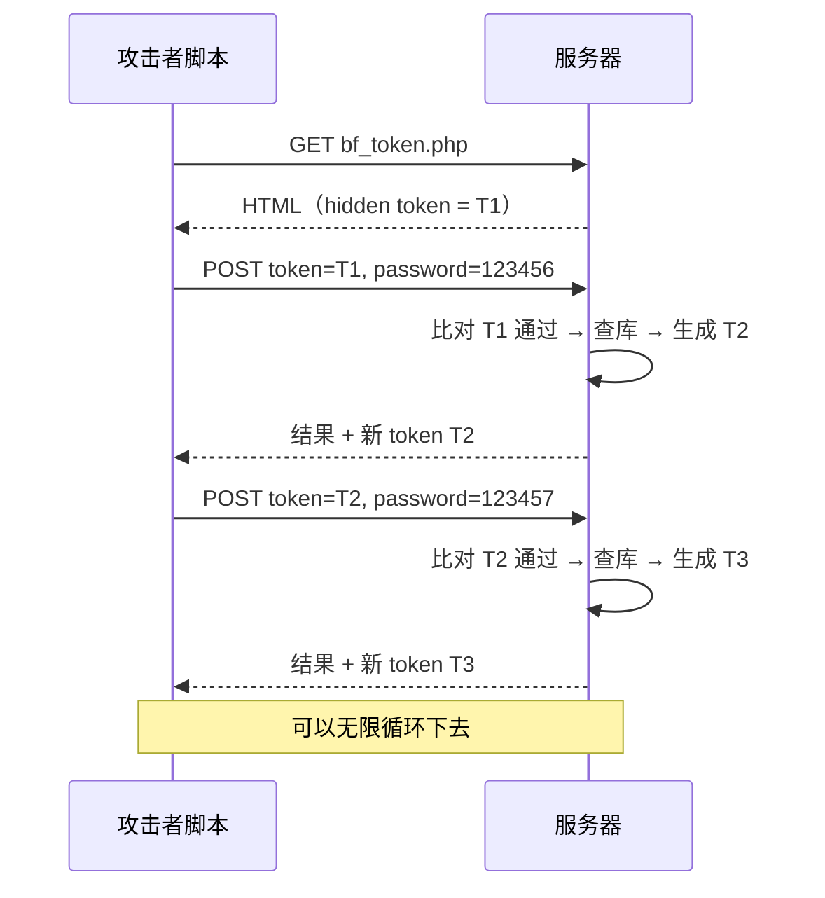

# token 挡得住 CSRF，挡不住爆破：Pikachu「token防爆破?」复盘
> 打开这关，我填了 `admin` / `123456`，一次就进去了。没有验证码，没有多出来的框，只有一个藏在 HTML 里的 hidden 字段。后来才想明白——这关的题目本身带着问号，作者其实在反问：**token 真的能防爆破吗？**
## 一、环境与目标
| 项目 | 内容 |
| --- | --- |
| 靶场 | Pikachu |
| 运行环境 | phpStudy（Apache 2.4.39 + MySQL 5.7.26 + PHP 7.3.4 NTS） |
| 站点根目录 | `D:\Pikachu` |
| 访问方式 | `http://pikachu/` |
| 关卡位置 | 暴力破解 → token防爆破? |
| 页面地址 | `http://pikachu/vul/burteforce/bf_token.php` |
| 工具 | 浏览器、Burp Suite、Python |
## 二、这道题在考什么
### 2.1 页面上多了一个看不见的字段
表单里多了一行：
```html
<input type="hidden" name="token" value="<?php echo $_SESSION['token']; ?>" />
```
它在页面上不显示，但**每次提交都会跟着发出去**。打开 F12 就能看到它的值，长这样：
```
448096aec2a942060b681765193
```
### 2.2 后端的校验
`bf_token.php`：
```php
if(isset($_POST['submit']) && $_POST['username'] && $_POST['password'] && $_POST['token']){
    $username = $_POST['username'];
    $password = $_POST['password'];
    $token    = $_POST['token'];
    $sql = "select * from users where username=? and password=md5(?)";
    $line_pre = $link->prepare($sql);
    $line_pre->bind_param('ss', $username, $password);
    if($token == $_SESSION['token']){          // ← 先验 token
        if($line_pre->execute()){
            // ...查密码，返回 login success / not exists
        }
    } else {
        $html .= '<p> csrf token error</p>';   // ← token 不对直接拒绝
    }
}
// 生成 token（每次请求都会执行）
set_token();
```
注意最后那句 `set_token()` 在 `if` 外面，**每次页面渲染都会跑一次**。
### 2.3 token 是怎么生成的
`inc/function.php`：
```php
function set_token(){
    if(isset($_SESSION['token'])){
       unset($_SESSION['token']);
    }
    $_SESSION['token'] = str_replace('.', '', uniqid(mt_rand(10000,99999), true));
}
```
用 `uniqid()` 加一个随机前缀，再把小数点去掉，拼成一串二十多位的字符。
里面有两个成分：
- `mt_rand(10000,99999)`：随机前缀
- `uniqid(..., true)`：**基于当前微秒时间**的一串值
所以 token **每次都会变**，而且变的原因有三：换会话、换请求、换时间。
### 2.4 关键：token 是一次性的，但每次响应都给你新的
这是我做完实验才确认的：
```
[1] GET 页面        → token T1 = 448096aec2a942060b681765193
[2] 用 T1 提交      → 密码错误（token 被接受），响应里给出新 token T2
[3] 复用旧 T1 提交  → csrf token error
[4] 用 T2 提交      → csrf token error（因为第 3 步已经把 T2 刷掉了）
```
第 4 步很有意思：**连失败请求也会让 token 轮换。** 因为 `set_token()` 在 `if` 外面，不管校验成不成功，页面一渲染就重新生成。
## 三、常规操作（你以为的解法）
按前几关的惯性，可能会想：
1. 抓包；
2. 把 `password` 设成爆破点；
3. 挂字典跑。
但一跑就会发现：**除了第一条，后面全返回 `csrf token error`。**
因为 `token` 只能用一次，而 Intruder 把同一条请求原样重放几百遍，token 早就废了。
## 四、我的实际操作
说实话，我没抓包，也没爆破。
打开页面，`admin` / `123456`，点 Login——
```
login success
```
一次就过了。
**原因很简单：`admin/123456` 本来就是正确答案**（Pikachu 的三个默认账号之一，前几关已经记过了）。而 token 对于「一次正常的表单提交」是完全放行的。
所以这次"成功"只能说明：**token 不会妨碍合法用户登录**。它到底能不能防爆破，一点都没验证到。
## 五、为什么 token 没挡住爆破
### 5.1 token 防的不是爆破，是 CSRF
token 这个东西的学名是 **CSRF Token**，它要防的是「跨站请求伪造」：
> 你登录了 A 网站，然后访问了恶意网站 B。B 的页面里藏了一个自动提交到 A 的表单。因为浏览器会自动带上你在 A 的 Cookie，A 就以为是你在操作。
加了 token 之后，B 就伪造不了了——因为 **B 的页面读不到 A 页面里的 token**。
关键在于：**token 的防御对象是"另一个网站"，不是"攻击者本人的脚本"。**
### 5.2 攻击者的脚本能自己读 token
CSRF 攻击者受限于同源策略，读不到别人页面的内容。
但一个直接对目标发起请求的脚本，**它自己就是浏览器**——它请求页面、拿到 HTML、用正则把 token 抠出来，完全是合法的客户端行为。
### 5.3 实验：一边取 token，一边爆破
写个循环就行：
```python
tok = 从页面里抓出来的 token
for pwd in 字典:
    resp = POST(username=admin, password=pwd, token=tok)
    if "login success" in resp:
        找到密码了
        break
    tok = 从 resp 里抓新的 token     # ← 关键这一行
```
结果：
```
=== [5] 边取 token 边爆破 ===
    [+] HIT at try #1  password = 123456
    elapsed 0.04s
[*] re-login: SUCCESS
```
整个流程：

**token 一次一换，但每次换完都主动告诉你新的。** 所以对脚本来说，token 根本构不成障碍，只是多了一步正则提取。
### 5.4 那 token 到底有没有用
有用，但用在别处。
| 防御目标 | token 有用吗 | 原因 |
| --- | --- | --- |
| CSRF（第三方站点伪造请求） | ✅ 有用 | 别的站点读不到你的 token |
| 暴力破解（脚本自己发请求） | ❌ 没用 | 脚本能自己读 token |
| 自动化爬取/重放 | ❌ 没用 | 同上 |
| 重复提交（防抖） | ✅ 一次性 token 可以 | 同一个 token 用第二次就报错 |
页面右上角的提示写得很直白：
> token了解下,后面搞CSRF会用到....**虽然这里并没有什么鸟用。**
作者自己就在说：这玩意儿放在爆破关卡里，没啥用。
## 六、真正防爆破要靠什么
token 不是没用，而是**用错了地方**。防爆破靠的是这三样：
| 措施 | 作用 | 这关有吗 |
| --- | --- | --- |
| 失败次数锁定 | 连续错 N 次锁账号/IP | ❌ |
| 请求频率限制 | 每秒最多几次 | ❌ |
| 验证码（且服务端校验） | 增加单次成本 | ❌ |
三者一个都没有，只加了一个"一次性 token"——而一次性 token 的轮换成本，对脚本来说是一行正则。
## 七、笔记知识
### 7.1 token 是什么
| 问题 | 回答 |
| --- | --- |
| 存在哪 | 服务端 `$_SESSION['token']` |
| 怎么给前端 | 渲染成 `<input type="hidden" name="token">` |
| 有效期 | 一次（这次请求用完就换） |
| 谁在读它 | 表单提交时浏览器自动带上 |
| 防什么 | CSRF——第三方网站伪造请求 |
| 不防什么 | 爆破、重放、脚本自动化 |
### 7.2 三类"防护"的对比
|  | 验证码 | CSRF Token | 频率限制 |
| --- | --- | --- | --- |
| 防爆破 | ✅ 有效（前提是服务端验） | ❌ 无效 | ✅ 最有效 |
| 防 CSRF | ❌ 无关 | ✅ 专用 | ❌ 无关 |
| 对脚本的门槛 | 需要识别图片/逻辑 | 只需一次正则 | 需要绕过限速 |
| 关键点 | 服务端校验 + 不泄露 | 不可预测 + 不可读 | 阈值 + 锁定 |
### 7.3 一句话记住
> **token 是发给"浏览器"的通行证，不是发给"服务器"的锁。**
> 谁能读到它，谁就能用它。而脚本，永远读得到。
## 八、我学到了什么
### 8.1 一个安全措施要先问"它在防谁"
token 设计出来是防"另一个网站"，不是防"本人的脚本"。把 token 放到爆破关卡里，等于拿防盗门去防隔壁邻居——对象错了，再多也白搭。
以后看到任何防护措施，先问一句：**它的威胁模型是谁？**
### 8.2 一次性 ≠ 安全
这关的 token 确实一次性，第二次用就报 `csrf token error`。但它每次都在响应里告诉你新的。
**"一次性"和"不可获取"是两个独立条件。** 只满足前者，等于换了个密码但把新密码贴在门上。
### 8.3 轮换的东西，要确认它怎么轮换
`set_token()` 写在 `if` 外面，所以**连失败的请求都会刷新 token**。
这个细节有好有坏：
- 好：token 的暴露窗口很短
- 坏：自动化脚本必须每次从响应里重新提取，不能"一次抓包跑到底"
如果它是写在 `if` 里面（只在成功后刷新），爆破脚本反而更省事。
### 8.4 手工成功不等于漏洞不存在
我这次"一次就进"，毫无技术含量——`123456` 本来就是答案。
这也是一种陷阱：**页面上能登进去，说明不了任何防护有效或无效。** 判断防护有没有用，要看的是"连续失败几次之后会发生什么"。
## 九、防御怎么写才对
```php
// 生成（服务端，每次渲染替换）
set_token();
// 校验 + 立即销毁
if (!hash_equals($_SESSION['token'] ?? '', $_POST['token'] ?? '')) {
    exit('csrf token error');
}
unset($_SESSION['token']);
// 业务逻辑
...
// 再加一层：失败计数
if ($fail_count >= 5) {
    // 锁定 / 加验证码 / 延迟响应
}
```
三条原则：
1. **token 只负责 CSRF**，别指望它防爆破；
2. **防爆破必须有"次数"概念**——锁定、限速、延迟，三者至少一个；
3. **token 用 `hash_equals()` 比较**，避免时序侧信道（这题用的是 `==`，属于次要问题）。
## 十、下一关
- [x] 基于表单的暴力破解
- [x] 验证码绕过（on server）
- [x] 验证码绕过（on client）
- [x] token 防爆破？
暴力破解模块到这里就通关了。接下来的模块：
- Cross-Site Scripting（反射型 / 存储型 / DOM 型）
- CSRF（这里会真正用到 token 的知识）
- SQL-Inject
- RCE、文件包含、文件上传……
## 参考
- [Pikachu 源码](https://github.com/zhuifengshaonianhanlu/pikachu)
- [小皮面板官网](https://www.xp.cn/)
- [Burp Suite 官方文档](https://portswigger.net/burp/documentation)
- [OWASP: Cross-Site Request Forgery](https://owasp.org/www-community/attacks/csrf)
---
**一句话总结**：这关的题目带了个问号，答案就是"不能"。token 防的是第三方网站伪造请求，而脚本自己就能把 token 读出来——**一次性不等于不可获取，随机不等于不可读。**
